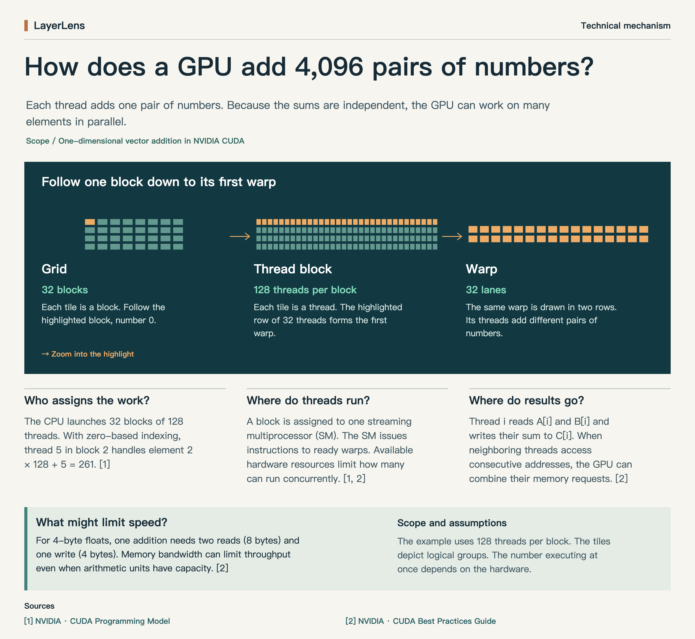

# LayerLens

LayerLens turns a question about a technical system or an industry into one zoomable, source-linked diagram. For a mechanism, follow an input through the parts that transform it. For a value chain, follow a deliverable across suppliers and see how customer requirements travel back upstream.

[简体中文](README.zh-CN.md)

## Examples

[](examples/gpu.svg)

**How does a GPU add 4,096 pairs of numbers?** Zoom from a grid to a single warp, trace thread 5 in block 2 to element 261, and see why memory bandwidth can limit throughput. [Vector diagram](examples/gpu.svg) · [Editable data](examples/gpu.json)

**How does a robot arm become a welding cell?** Follow the component maker, robot maker, integrator and factory. The diagram traces a fixture error back to the weld path and shows how the fix can affect cycle time. [View the diagram](examples/robotics.png) · [Vector diagram](examples/robotics.svg) · [Editable data](examples/robotics.json)

## Try it in a browser

1. Download [the offline viewer](https://github.com/H8AB/LayerLens/releases/download/v0.3.0/LayerLens.html) and open it in a browser. Both examples are included.
2. Copy [the web prompt](releases/layerlens-web-prompt.txt) into your AI chat and add a question or source material.
3. Paste the resulting JSON into the viewer. Edit the text, zoom in, or export an SVG or a 3,200-pixel-wide PNG.

The viewer runs locally. It opens in English. Select **简体中文** for Chinese controls, examples and prompt.

## Install the skill

- **Codex** — Copy [the skill folder](skill/strata-atlas) into your project's `.agents/skills/` directory. Invoke it with `$strata-atlas`.
- **Claude Code** — Copy the same folder into `.claude/skills/` and use `/strata-atlas`.
- **Claude web** — Upload the [Agent Skills ZIP](https://github.com/H8AB/LayerLens/releases/download/v0.3.0/layerlens-0.3.0-agent-skills.zip) in Customize → Skills. Your workspace needs to permit custom skills and file creation.
- **WorkBuddy** — In the skills manager, choose Add → Upload and select the [WorkBuddy ZIP](https://github.com/H8AB/LayerLens/releases/download/v0.3.0/layerlens-0.3.0-workbuddy.zip).

The skill ID is `strata-atlas` for compatibility with earlier versions. Try asking *“Trace a welding cell from joint components to the finished weld. What changes if the fixture shifts?”*

## Render and develop

Use Node.js 18+ for the renderer and Python 3.9+ to rebuild the distributions. Both use their standard libraries.

```sh
node skill/strata-atlas/scripts/render.mjs examples/gpu.json gpu.svg
python3 scripts/build.py
node --test tests/*.test.mjs
```

The [diagram format](skill/strata-atlas/references/format.md) covers diagram types, annotations, sources and language. Open a standalone SVG in a browser to follow its source links. Earlier One Picture Explainer flow and grid files can also be opened.

[MIT license](LICENSE). Illustrations are original vector drawings. The cited material belongs to its respective rights holders.
